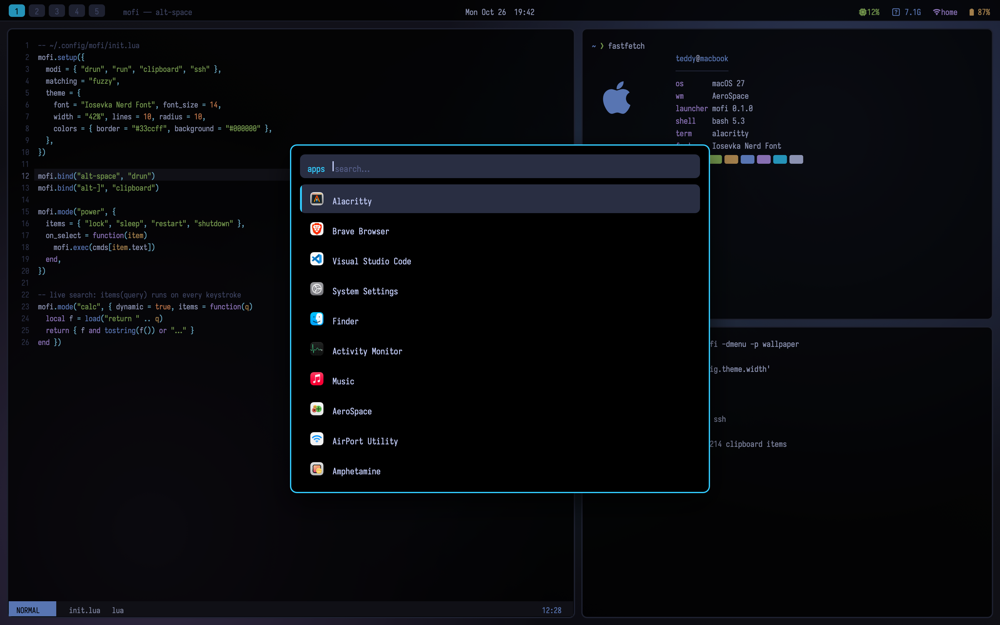
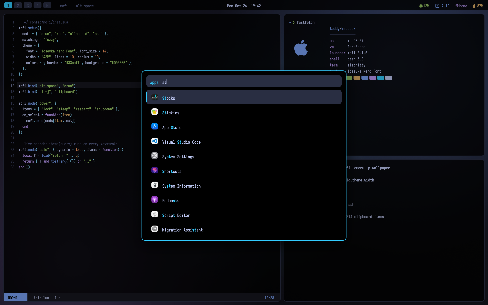
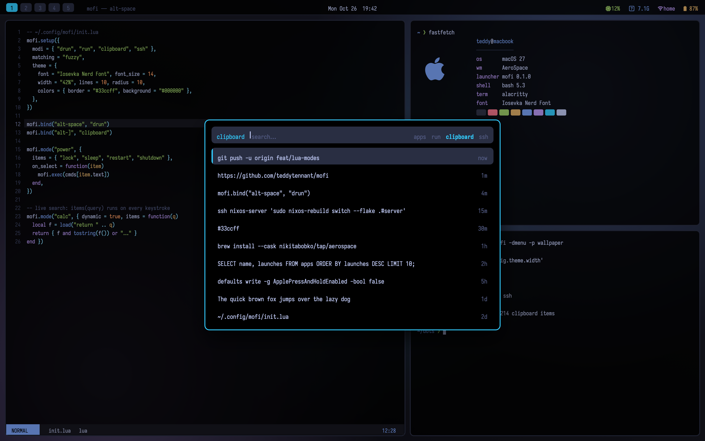
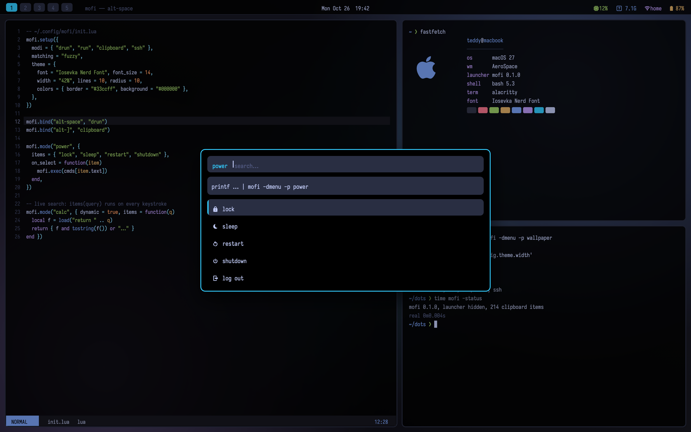
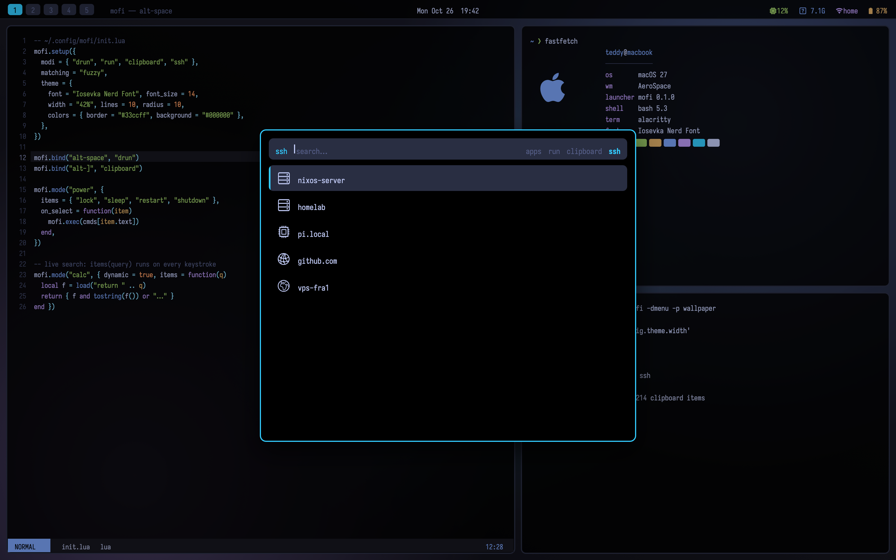

# mofi

A fast, native, rofi-style launcher for macOS. Apps, commands, clipboard history, ssh and `dmenu`, configured and scripted in Lua.



```sh
curl -fsSL https://raw.githubusercontent.com/teddytennant/mofi/main/install.sh | bash
```

Then press <kbd>alt</kbd>+<kbd>space</kbd> for apps and <kbd>alt</kbd>+<kbd>]</kbd> for clipboard history.

- **Instant.** A resident ~2 MB native daemon with a prebuilt window: no Electron, no web view, no Spotlight index.
- **rofi-compatible.** `-show`, `-modi`, `-dmenu`, `-p`, `-format`, `-auto-select` and rofi script modes behave the same, so your scripts keep working.
- **Lua all the way down.** Config, theme, keys, hotkeys and custom modes all live in one `init.lua`.

| | |
|---|---|
|  |  |
|  |  |

## Docs

- [Getting started](docs/getting-started.md): install, hotkeys, permissions, AeroSpace
- [Configuration](docs/configuration.md): every option in `init.lua`
- [Theming](docs/theming.md): colors, fonts, layout
- [Keybindings](docs/keybindings.md): in-launcher keys and global hotkeys
- [Modes](docs/modes.md): drun, run, clipboard, ssh, combi, dmenu
- [Lua API](docs/lua-api.md): custom modes, menus, scripting
- [CLI](docs/cli.md): flags and exit codes
- [Coming from rofi](docs/migrating-from-rofi.md)

## Build from source

```sh
git clone https://github.com/teddytennant/mofi && cd mofi
swift build -c release && cp .build/release/mofi ~/.local/bin/
```

Needs macOS 13+ and the Xcode Command Line Tools. Lua 5.4 is vendored, so there are no other dependencies.

MIT licensed.
